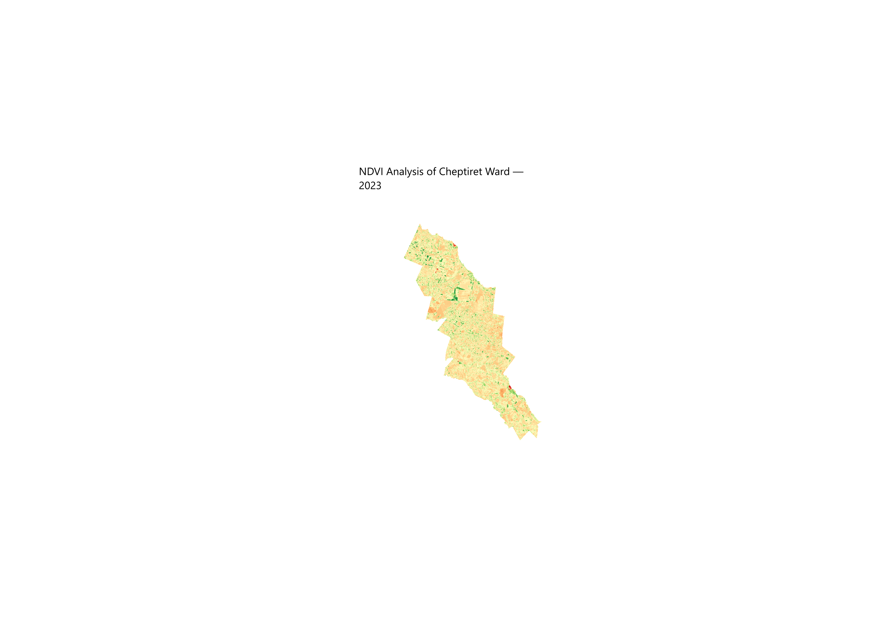
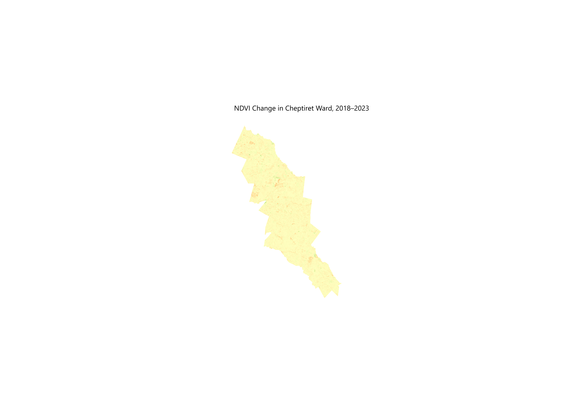

# Cheptiret Ward NDVI Change Analysis (2018–2023)

## 1. Project Overview

This project examines changes in vegetation conditions in Cheptiret Ward, Kesses Sub-County, Uasin Gishu County, Kenya, between 2018 and 2023. It uses Sentinel-2 satellite imagery and Geographic Information Systems (GIS) to calculate and compare the Normalized Difference Vegetation Index (NDVI).

The project was completed using QGIS. It demonstrates how satellite imagery and spatial analysis can be used to monitor vegetation conditions over time.

## 2. Project Objectives

- Calculate NDVI for 2018 and 2023.
- Map vegetation conditions for both years.
- Calculate the difference between the two NDVI layers.
- Identify areas where NDVI increased or decreased.

## 3. Study Area

The study area is Cheptiret Ward in Kesses Sub-County, Uasin Gishu County, Kenya.

## 4. Data Sources and Tools

- **Satellite imagery:** Sentinel-2.
- **GIS software:** QGIS.
- **Vegetation index:** Normalized Difference Vegetation Index (NDVI).
- **Analysis:** Raster calculation, clipping, map styling, and comparison of NDVI values.

NDVI was calculated using the near-infrared (NIR) and red bands:

NDVI = (NIR − Red) / (NIR + Red)

## 5. Maps and Results

### NDVI Map — 2018

This map shows the spatial distribution of vegetation greenness in Cheptiret Ward in 2018.

### NDVI Map — 2023

This map shows vegetation greenness in Cheptiret Ward in 2023.

### NDVI Change Map — 2018 to 2023

This map represents the difference between the 2023 and 2018 NDVI values.

Positive NDVI differences indicate an increase in NDVI, while negative differences indicate a decrease. These changes describe vegetation-index patterns and do not, by themselves, establish the causes of vegetation change.

## 6. Skills Demonstrated

- Satellite imagery processing.
- NDVI calculation using raster bands.
- Raster clipping and spatial analysis in QGIS.
- Raster visualisation and map production.
- Comparing vegetation conditions across different years.
- Documenting a GIS project using GitHub.

## 7. Conclusion

This project demonstrates a practical workflow for analysing and mapping vegetation conditions using satellite imagery and open-source GIS software. Comparing NDVI for 2018 and 2023 provides a basis for identifying spatial differences in vegetation greenness within Cheptiret Ward.

The maps should be interpreted alongside information about rainfall, cropping patterns, land management, and other factors before drawing conclusions about the causes of observed changes.
